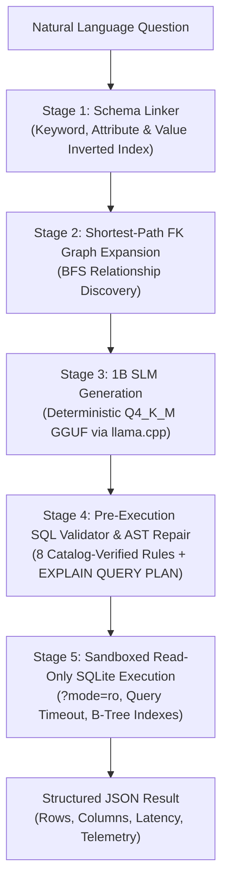

# 5-Stage Text-to-SQL Production Pipeline Skill

This skill provides step-by-step procedures and design principles for developing, maintaining, and extending the enterprise Text-to-SQL system in `d:/SLM`.

---

## When to Use This Skill

Activate and follow this guide when:
- Adding, altering, or re-indexing relational tables in `backend/database/setup.py`.
- Modifying or extending AST validation and repair rules in `backend/services/sql_validator.py`.
- Modifying keyword matching or BFS foreign-key path discovery in `backend/services/schema_linker.py`.
- Tuning model prompt construction, sampling temperature, or GGUF runtime settings in `backend/services/sql_generator.py`.
- Running or adding queries to the 20-query head-to-head benchmark in `backend/stress_test.py`.
- Extending the Streamlit interface (`frontend/app.py`) with new analytical views or visualizations.

---

## The 5-Stage Architecture Flow

Every query must strictly navigate through the following five stages:



---

## Stage-by-Stage Implementation Guide

### Stage 1: Schema Linking (`backend/services/schema_linker.py`)
- **Purpose:** Prunes the full catalog down to only the tables relevant to the user question.
- **Rules to maintain:**
  1. Never pass all tables to the 1B model. The model was trained without distractor tables; passing irrelevant tables induces false multi-table joins.
  2. Maintain the inverted categorical index (`value_to_table_col`) for text columns with cardinality $\le 20$.
  3. Token matching must handle stemming (e.g., `"employees"` $\rightarrow$ `Employees`, `"categories"` $\rightarrow$ `category`).
  4. Attribute matching must only pull in tables for attributes *not* already covered by primary anchor tables.

### Stage 2: Foreign-Key Path Expansion (`backend/services/schema_linker.py`)
- **Purpose:** Automatically bridges disconnected tables identified in Stage 1.
- **Rules to maintain:**
  1. The foreign-key graph is built dynamically from `PRAGMA foreign_key_list`.
  2. Use Breadth-First Search (BFS) to find the shortest bridge path (e.g., `Users` $\leftrightarrow$ `Orders` $\leftrightarrow$ `Products`).
  3. Preserve table order consistent with `sqlite_master` to ensure deterministic prompt creation.

### Stage 3: SLM Generation (`backend/services/sql_generator.py`)
- **Purpose:** Translates schema + question into relational SQL tokens.
- **Rules to maintain:**
  1. **Strict Prompt Format:** Always use the Alpaca template:
     ```text
     Below is an instruction that describes a task, paired with an input that provides further context. Write a response that appropriately completes the request.

     ### Instruction:
     Write a SQL query to answer this question: {question}

     ### Input:
     {context}

     ### Response:
     {answer}
     ```
  2. **Deterministic Sampling:** `temperature=0.0`, greedy decoding, stopping on `<|eot_id|>`, `<|end_of_text|>`, and `###`.
  3. Clean generated SQL of markdown fences (` ```sql `), trailing semicolons, and conversational filler.

### Stage 4: Pre-Execution SQL Validator & AST Repair (`backend/services/sql_validator.py`)
- **Purpose:** Catches and corrects common 1B generation quirks before execution.
- **Mandatory repair sequence:**
  1. `_strip_unknown_joins`: Strip joins to tables outside the linked schema and duplicate self-joins.
  2. `_fix_join_on_clauses`: Re-align `JOIN ... ON` equality predicates to match actual catalog foreign keys.
  3. `_fix_alias_columns`: Correct alias-to-column ownership mismatches across joined tables.
  4. `_inject_missing_fk_join`: Inject joins if a query filters on an FK-referenced column.
  5. `_strip_unmentioned_filters`: Strip hallucinated WHERE predicates containing literals absent from the question.
  6. `_fix_value_filter_columns`: Re-align filter columns using `value_to_table_col`.
  7. `_where_to_having_avg`: Convert `WHERE AVG(col) > N` to `HAVING AVG(col) > N`.
  8. `_count_to_sum`: Convert `COUNT(*)` to `SUM(col)` when asking for `"total <metric>"`.
  9. `_remove_spurious_group_by`: Remove unnecessary `GROUP BY` from non-grouped single-aggregate queries.
  10. `_project_group_column`: Ensure `GROUP BY` column is selected in `SELECT`.
- **Validation gate:** Run `EXPLAIN QUERY PLAN <sql>`. If an error occurs, invoke a bounded 1-turn LLM correction prompt.

### Stage 5: Sandboxed Read-Only SQLite (`backend/database/`)
- **Purpose:** Safe, low-latency execution over 75,858 rows.
- **Rules to maintain:**
  1. Connect with URI parameter `?mode=ro` (`uri=True`).
  2. Set a 5-second progress handler timeout via `set_progress_handler` to prevent Cartesian denial-of-service.
  3. Hard cap rows returned at 5,000.
  4. Only allow `SELECT` and `WITH` statements.

---

## Verification & Benchmarking Procedure

Whenever changing backend services, database schemas, or validation rules:

1. **Re-seed database if schema was modified:**
   ```powershell
   python -m backend.database.setup
   ```
2. **Execute the 20-Query Stress Test Benchmark:**
   ```powershell
   python -m backend.stress_test
   ```
3. **Success Criteria:**
   - 5-Stage Pipeline Execution Rate: **`20/20 (100.0%)`**.
   - 5-Stage Pipeline Exact Match (EX): **`20/20 (100.0%)`**.
   - Database Execution Latency: **`< 25 ms`** per query.

