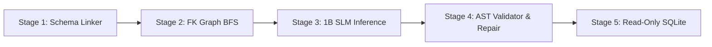

# Agent Guidelines & Project Architecture Rules

This repository contains an Enterprise Text-to-SQL Analytics Platform powered by a fine-tuned 1B Small Language Model (SLM), a 5-Stage deterministic inference engine, and a Streamlit visualization dashboard.

All agents, contributors, and automated tooling modifying this codebase **MUST ALWAYS** comply with the following architectural principles and conventions.

---

## 1. Import Organization Rules (Mandatory)

Always order imports in every Python file into two clear sections:
1. **External / Third-Party Packages** (e.g., standard library, `fastapi`, `pydantic`, `streamlit`, `requests`, `pandas`, `plotly`, `llama_cpp`, `dotenv`, `weave`).
2. **Internal Module Imports** (e.g., `from backend.config import ...`, `from backend.services.schema_linker import ...`).

Separate standard library, external packages, and internal project imports cleanly with single blank lines:
```python
# Standard library & external packages
import os
import re
from typing import Any

from dotenv import load_dotenv
import pandas as pd
import requests
import streamlit as st

# Internal imports
from backend.config import DATABASE_PATH
from backend.services.schema_linker import schema_linker
```

---

## 2. Directory & File Naming Conventions

- Directory and file names must be self-explanatory and explicitly describe their single responsibility.
- Snake_case for Python files (`schema_linker.py`, `sql_generator.py`, `sql_validator.py`, `query_executor.py`).
- Follow the clean layered structure:
  - `backend/controllers/`: Route coordination, orchestration logic.
  - `backend/database/`: SQLite connection, DDL setup, progress handlers, read-only querying.
  - `backend/routes/`: FastAPI endpoint declarations.
  - `backend/schemas/`: Pydantic request and response contracts.
  - `backend/services/`: Core algorithmic intelligence (Stages 1–4 of the pipeline).
  - `frontend/`: Streamlit dashboard and visual presentation components.

---

## 3. Code Simplicity & Anti-Hack Policies

- **Keep code as simple as possible:** Prefer readable, standard Python paradigms over convoluted metaprogramming, excessive nested functions, or dense regexes when a cleaner structure exists.
- **No Mock or Fallback Cheating:** Never use hardcoded mock SQL responses (`_fallback_query`), hardcoded answer dictionaries, or hacky workarounds. All queries must flow through the genuine 5-Stage pipeline and execute against the real SQLite database.
- **Principle of Separation of Concerns:**
  - The model does relational semantic reasoning.
  - The Schema Linker prunes extraneous tables to protect the context window.
  - The SQL Validator enforces deterministic catalog rules (foreign keys, aliases, `GROUP BY` projections).
  - The Database enforces security at the OS/driver level.

---

## 4. The 5-Stage Production Pipeline Invariant

Any modifications to query generation, inference, or execution must preserve the 5 distinct pipeline stages:



1. **Stage 1 (Schema Linker):** Introspects catalog, indexes low-cardinality categorical values ($\le 20$ values), and matches table tokens.
2. **Stage 2 (FK Graph Expansion):** Uses Breadth-First Search (BFS) over `PRAGMA foreign_key_list` to automatically pull in intermediate bridge tables.
3. **Stage 3 (SLM Generation):** Autoregressive GGUF inference via `llama.cpp` using greedy decoding (`temperature=0.0`) and the exact Alpaca prompt format.
4. **Stage 4 (Pre-Execution Validator):** Deterministic AST repair (FK `ON` clause repair, cross-table alias repair, unmentioned filter stripping, `COUNT(*)` $\rightarrow$ `SUM(col)` correction, `GROUP BY` projection alignment) and `EXPLAIN QUERY PLAN` validation with bounded 1-turn self-correction.
5. **Stage 5 (Read-Only Execution):** Read-only URI mode (`file:...analytics.db?mode=ro`, `uri=True`), 5-second instruction ceiling via `set_progress_handler`, and 5,000-row cap.

---

## 5. Security & Read-Only Guarantees

- **Never bypass read-only mode:** Every runtime query must connect with `?mode=ro`.
- **Whitelisting:** Only `SELECT` or `WITH` queries are permitted. Semicolons within queries or multi-statement payloads must be rejected immediately.
- **Secrets Management:** Never hardcode credentials, API tokens, or secrets. Always read from environment variables or `.env` via `python-dotenv`.

---

## 6. Streamlit Frontend Standards

- Do not use deprecated `use_container_width=True`; use `width="stretch"` or `width="content"`.
- Prefer native Streamlit elements (`st.dataframe`, `st.container(border=True)`, `st.segmented_control`, `st.tabs`, `st.mermaid_chart`) over raw HTML or `unsafe_allow_html`.
- Maintain self-healing fallbacks: if the backend server is temporarily starting or offline, frontend data viewers (such as the Schema & ER Graph) must fail gracefully or inspect the local database directly.

---

## 7. Skill Reference

For detailed development runbooks, refer to:
- `.agents/skills/text-to-sql-pipeline/SKILL.md`: The operational guide for testing, extending, and benchmarking the 5-stage Text-to-SQL pipeline.
- `docs/architecture.md`: Comprehensive system architecture and data-flow documentation.
- `docs/testing_and_benchmarking.md`: Head-to-head benchmarking standards across the 75,858-row database.

