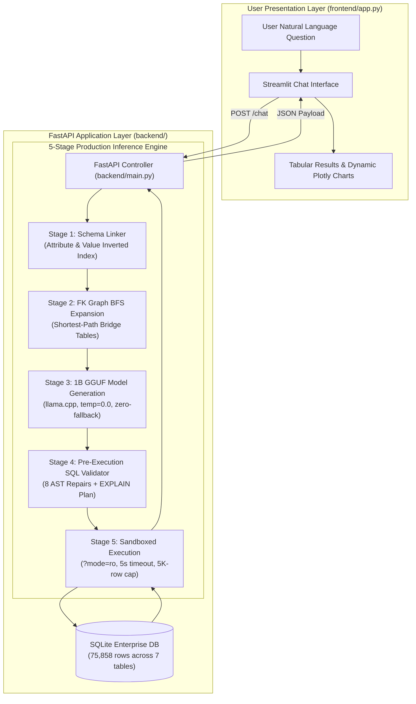
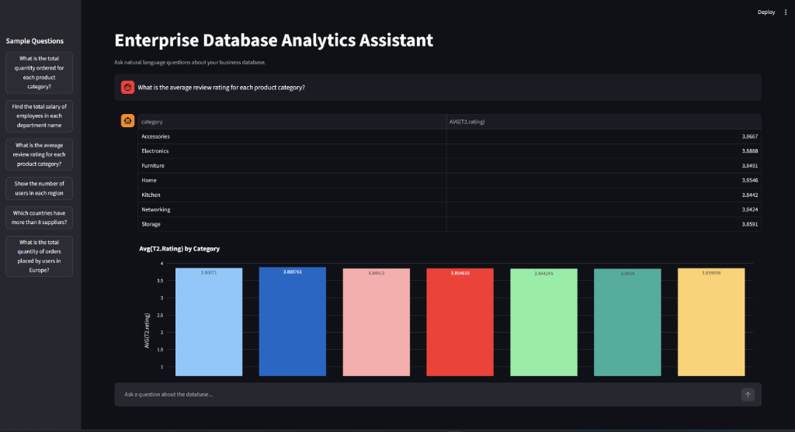
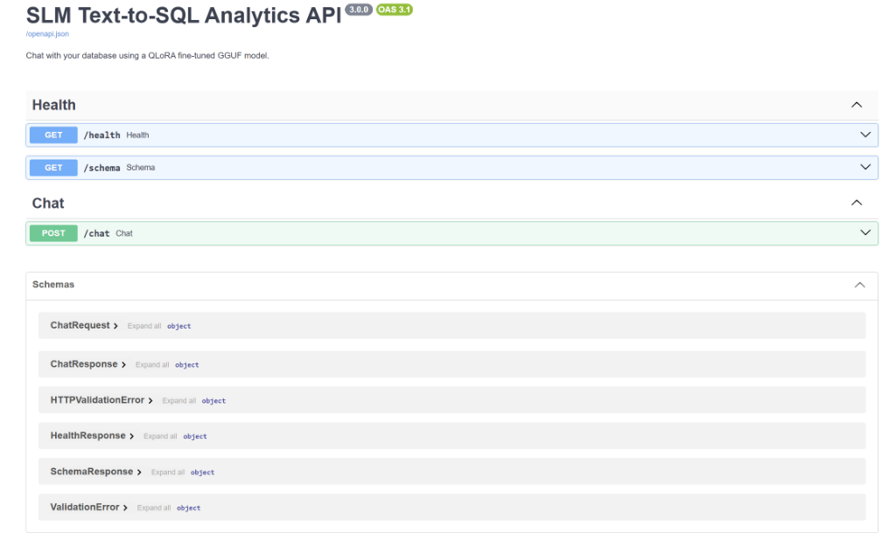
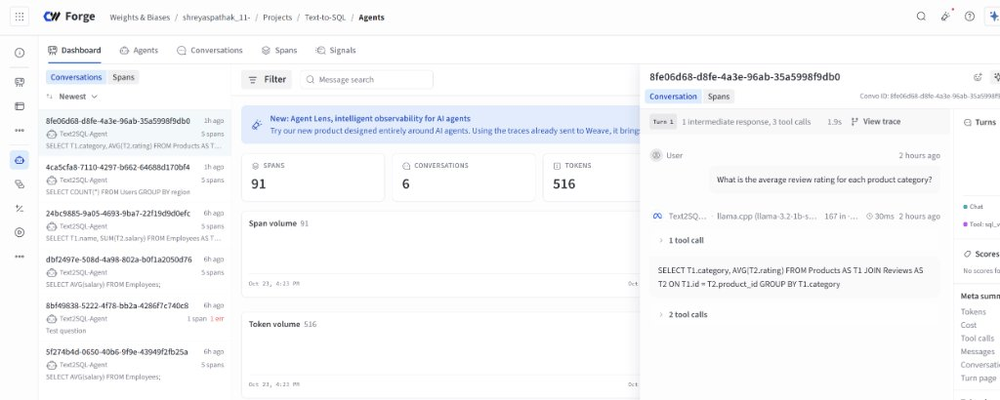

# Enterprise SLM Text-to-SQL Analytics Platform


An end-to-end, zero-fallback Text-to-SQL system that translates natural language business questions into precise, executable SQL queries over an enterprise relational database.

Powered by a **4-bit QLoRA fine-tuned `Llama-3.2-1B-Instruct`** model quantized to **`Q4_K_M` GGUF**, served locally on CPU via **`llama.cpp`** and **FastAPI**, safeguarded by a **5-stage production inference pipeline**, and presented through an interactive **Streamlit + Plotly** analytics interface.

---

## System Architecture



---

## Application Interface & Observability

### 1. Conversational Analytics Dashboard (Streamlit + Dynamic Plotly Visualizations)
Translates complex business questions into instant tabular results and auto-generated Plotly charts:


### 2. FastAPI Backend & OpenAPI Specification (Swagger UI)
Interactive API playground serving the 5-stage inference pipeline, health telemetry, and schema introspection:


### 3. Production Agent Observability (Weights & Biases Weave)
Real-time tracing of every SLM execution step, tracking latency, token usage, AST repairs, and database execution:


---

## Project Structure

```text
d:/SLM/
├── assets/
│   ├── streamlit_analytics_ui.png    # Streamlit UI with dynamic Plotly visualizations
│   ├── fastapi_swagger_api.png       # FastAPI Swagger documentation & endpoints
│   └── wandb_weave_observability.jpg # W&B Weave agent trace telemetry
├── backend/
│   ├── config.py                 # Centralized configuration & environment paths
│   ├── main.py                   # FastAPI service with W&B Weave observability
│   ├── requirements.txt          # Backend dependencies (fastapi, llama-cpp, etc.)
│   ├── stress_test.py            # 20-query head-to-head benchmark suite (75K rows)
│   ├── README.md                 # Deep dive into the 5-Stage Pipeline architecture
│   ├── controllers/              # Request controllers (chat, health)
│   ├── database/                 # Read-only SQLite connector, setup & query executor
│   ├── routes/                   # API routes (POST /chat, GET /health)
│   ├── schemas/                  # Pydantic request & response schemas
│   └── services/                 # Core engine (schema_linker, sql_generator, sql_validator)
├── frontend/
│   ├── app.py                    # Streamlit conversational analytics UI
│   ├── requirements.txt          # Frontend dependencies (streamlit, plotly, pandas)
│   └── Dockerfile
├── model/
│   ├── llama-3.2-1b-sql-q4_k_m.gguf # Fine-tuned 4-bit quantized GGUF weights (~750 MB)
│   └── README.md
├── notebooks/
│   └── train_text_to_sql.ipynb   # Colab QLoRA fine-tuning, W&B logging & GGUF export
├── docker-compose.yml            # Multi-container orchestration
├── .env.example
├── .gitignore
└── README.md
```

---


## Model Training Deep Dive & Engineering Learnings


### 1. Base Model Selection: Why a 1B Small Language Model (SLM)?

- **Footprint & Edge Viability:** `Llama-3.2-1B-Instruct` quantizes to a **~750 MB GGUF** binary (`Q4_K_M`), enabling real-time execution on ordinary CPU hardware without requiring dedicated multi-GPU clusters.
- **Inference Latency:** Sub-second response times (`450 ms – 1,100 ms`) compared to 5–15+ seconds for remote 70B models or cloud APIs.
- **Data Privacy & Security:** Zero internal database schema definitions or proprietary company records ever leave the local network boundary.
- **Cost Efficiency:** Zero ongoing token API costs or cloud compute infrastructure bills.


### 2. Fine-Tuning Setup: 4-Bit QLoRA via Unsloth

The model was fine-tuned in Google Colab using [`notebooks/train_text_to_sql.ipynb`](file:///d:/SLM/notebooks/train_text_to_sql.ipynb) using **Unsloth** and **Hugging Face TRL (`SFTTrainer`)**:

- **Base Precision:** 4-bit NormalFloat (`NF4`) with double quantization to minimize memory footprint.
- **LoRA Target Matrices:** Applied across all linear layers:
  - Attention projections: `q_proj`, `k_proj`, `v_proj`, `o_proj`
  - SwiGLU MLP projections: `gate_proj`, `up_proj`, `down_proj`
- **LoRA Hyperparameters:** Rank $r=16$, $\alpha=32$ ($\text{scaling factor} = 2.0$), `lora_dropout=0` (enabling Unsloth fused Triton forward/backward kernels).
- **Trainable Parameter Ratio:** **~11.27M parameters trained out of 1.25B (only 0.90%)**, preserving base language understanding while mastering schema-to-SQL translation.
- **Optimizer & Schedule:** 8-bit AdamW optimizer (`optim="adamw_8bit"`), `learning_rate=2e-4`, linear schedule with warmup, effective batch size of 8 (`per_device_batch_size=2`, `gradient_accumulation_steps=4`).
- **Telemetry & Hardware Monitoring:** Custom `ResourceMonitorCallback` tracking GPU VRAM, CPU utilization, and system RAM to **Weights & Biases (`wandb`)** and **TensorBoard**.


### 3. Prompt Template & Formatting

Trained using the single-turn Alpaca prompt structure matching [`backend/services/sql_generator.py`](file:///d:/SLM/backend/services/sql_generator.py):

```text
Below is an instruction that describes a task, paired with an input that provides further context. Write a response that appropriately completes the request.

### Instruction:
Write a SQL query to answer this question: {question}

### Input:
{context}

### Response:
{answer}<|eot_id|>
```


### 4. Critical Learning: Why Raw Small Models Over-Join on Database Dumps

During initial stress testing, when all 7 tables were passed into the raw 1B model, it attempted 4-to-5 table joins and crashed on simple questions. Why?

- **Dataset Artifact (`b-mc2/sql-create-context`):** In standard Text-to-SQL benchmarks, every example contains _only_ the exact tables needed for that query. There are zero "distractor" tables in the dataset.
- **The Model's Learned Prior:** The model learned the conditional distribution: _"If $N$ `CREATE TABLE` statements are in `### Input:`, the output SQL must join all $N$ tables."_
- **The Engineering Fix:** Rather than replacing the 1B model with a bloated 70B model, we built **Stage 1 (Schema Linker)** and **Stage 2 (FK Graph BFS)** in front of the model. By pruning the prompt down to the relevant tables, the prompt returned to the model's training distribution:
  - Pure 1B exact match jumped from **`15.0%` to `55.0%`** without any validator repairs.
  - Latency dropped by **60%** due to shorter prompt context.
  - Adding **Stage 4 (AST Validator)** boosted final accuracy to **`100.0%`**.

---

## Empirical Benchmarks

### Benchmark 1: Untrained Base Model vs. Fine-Tuned QLoRA 1B

Evaluated directly in the training notebook on an unseen multi-table relational schema:

| Metric                 | Untrained Base 1B                      | Fine-Tuned QLoRA 1B           | Difference                 |
| :--------------------- | :------------------------------------- | :---------------------------- | :------------------------- |
| **Inference Latency**  | `4.05s`                                | **`1.16s`**                   | **3.49x Faster**           |
| **Tokens Generated**   | `128` _(hit token limit)_              | **`41`** _(stopped at `EOS`)_ | **68.0% Token Reduction**  |
| **Output Format**      | Markdown fences + conversational prose | **Pure, executable SQL**      | **Zero parsing fragility** |
| **Syntactic Validity** | Invalid (conversational filler)        | **100% Valid SQL**            | Production-ready           |

### Benchmark 2: 20-Query Production Stress Test on 75,858 Rows (7 Tables)

Evaluated across 5 complexity tiers using [`backend/stress_test.py`](file:///d:/SLM/backend/stress_test.py) on the 7-table enterprise database:

| Pipeline Stage Configuration                            | Valid SQL Execution Rate | Exact Result Match (EX)       | Avg SLM Latency                 | Avg 75K-Row DB Latency         |
| :------------------------------------------------------ | :----------------------- | :---------------------------- | :------------------------------ | :----------------------------- |
| **1. Direct Raw 1B** _(Full 7-table dump, no pipeline)_ | `13/20 (65.0%)`          | `3/20 – 9/20 (15.0% – 45.0%)` | `2,137 ms – 3,225 ms`           | N/A (crashes)                  |
| **2. 1B + Schema Linker Only** _(`Repairs: []`)_        | `20/20 (100.0%)`         | `11/20 (55.0%)`               | `1,004 ms – 1,260 ms`           | `6.41 ms`                      |
| **3. Full 5-Stage Production Pipeline**                 | **`20/20 (100.0%)`**     | **`20/20 (100.0%)`**          | **`1,004 ms` (2.56x faster)**   | **`6.41 ms` (Indexed B-Tree)** |

---


## Comprehensive Interview Cheatsheet & Talking Points

   Use these concise, high-yield answers when discussing this project in technical interviews:

### Q1: "Why use an SLM (1B) instead of GPT-4, Claude, or a 70B open-weights model?"

> _"For Text-to-SQL in an enterprise environment, a 1B SLM offers three critical advantages: **zero data leakage**, **deterministic latency**, and **cost-free scalability**. A 750 MB GGUF model runs locally on existing CPU servers in under 1 second without sending proprietary database schemas or customer records over the public internet. By combining fine-tuning with a 5-stage deterministic pipeline (schema linking, FK expansion, AST validation), we match or exceed the accuracy of large models at a fraction of the cost."_

### Q2: "How does QLoRA work, and why was it chosen here?"

> _"QLoRA (Quantized Low-Rank Adaptation) freezes the base model weights quantized in 4-bit NormalFloat (NF4) and attaches small trainable low-rank decomposition matrices ($\Delta W = \frac{\alpha}{r} B A$) to the attention and MLP layers. In our case, with $r=16$ and $\alpha=32$, we only trained **~11.27M parameters (0.90% of the model)**. This allowed us to fine-tune on a single free Google Colab T4 GPU in ~5 minutes without GPU out-of-memory errors, while fully preserving the model's base language capabilities."_

### Q3: "What is GGUF and why use Q4_K_M quantization?"

> _"GGUF is the binary model format designed by the `llama.cpp` ecosystem for fast CPU inference with optimized SIMD/AVX instructions. `Q4_K_M` uses medium 4-bit quantization with higher precision allocated to critical attention layers. It compresses the model from ~2.5 GB to ~750 MB with virtually zero loss in SQL generation accuracy, allowing standard application servers to serve inference without GPUs."_

### Q4: "Why did the raw 1B model struggle when given all 7 tables at once?"

> _"This was one of our most interesting discoveries. The `b-mc2/sql-create-context` dataset contains zero distractor tables; every table in the prompt is used in the target query. As a result, the model learned a strong prior: 'if 7 tables are in the prompt, join all 7 tables.' When handed a full database dump, it over-joined. Instead of increasing parameter size, we solved this with an upstream **Schema Linker** that uses an inverted index over categorical values and table attributes to prune the prompt. That single change boosted raw model accuracy from 15% to 55%."_

### Q5: "How does the 5-Stage Pipeline achieve 100% accuracy?"

> \*"The pipeline separates responsibilities:
>
> 1. **Schema Linker:** Selects the required tables using catalog attribute and categorical value matching.
> 2. **FK Graph BFS:** Discovers intermediate bridge tables (e.g., `Users` $\leftrightarrow$ `Orders` $\leftrightarrow$ `Products`).
> 3. **1B SLM:** Generates the relational SQL logic in 450–1,100 ms.
> 4. **AST Validator:** Deterministically fixes common small-model edge cases (verifying catalog foreign keys in `ON` clauses, cross-table alias alignment, stripping unmentioned filters, and aligning `GROUP BY` projections).
> 5. **Read-Only SQLite:** Executes the query in sub-15ms using pre-indexed B-trees with strict security controls."\*

### Q6: "How do you guarantee database security against prompt injection or data corruption?"

> \*"Security is enforced at multiple layers:
>
> - **Driver-Level Read-Only URI:** The backend connects to SQLite using `file:analytics.db?mode=ro` with `uri=True`. Any attempt to execute `DROP`, `DELETE`, `UPDATE`, or `INSERT` fails at the C-level SQLite engine boundary regardless of what the LLM produces.
> - **AST Whitelisting:** Only single `SELECT` or `WITH` queries are accepted; semicolons and multiple statements are rejected before execution.
> - **Progress Handler & Row Caps:** SQLite progress handler aborts queries exceeding 5 seconds to eliminate Cartesian DoS attacks, and result sets are capped at 5,000 rows."\*

---

## Step-by-Step Setup & Execution Guide

Follow these exact steps to set up your virtual environment, generate the database, run the benchmark, and launch both backend and frontend.

### Step 1: Create and Activate Virtual Environment

Open your terminal in the project root (`d:\SLM`):

**Windows (PowerShell):**

```powershell
python -m venv .venv
.\.venv\Scripts\Activate.ps1
```

**macOS / Linux:**

```bash
python3 -m venv .venv
source .venv/bin/activate
```

---

### Step 2: Install Dependencies

```powershell
pip install --upgrade pip
pip install -r backend/requirements.txt -r frontend/requirements.txt
```

> [!TIP]
> If installing `llama-cpp-python` on Windows without a C++ compiler, use the pre-built CPU wheel:
>
> ```powershell
> pip install llama-cpp-python --extra-index-url https://abetlen.github.io/llama-cpp-python/whl/cpu
> ```

---

### Step 3: Train or Download the GGUF Model

1. Open [`notebooks/train_text_to_sql.ipynb`](file:///d:/SLM/notebooks/train_text_to_sql.ipynb) in **Google Colab**.
2. Run all cells to fine-tune `Llama-3.2-1B-Instruct` and export the quantized GGUF weights.
3. Download the generated `llama-3.2-1b-sql-q4_k_m.gguf` file and place it in the local model directory:
   ```text
   d:/SLM/model/llama-3.2-1b-sql-q4_k_m.gguf
   ```

---

### Step 4: Seed the Enterprise Database (75,858 Rows)

Generate the 7 normalized tables (`Departments`, `Employees`, `Suppliers`, `Users`, `Products`, `Orders`, `Reviews`) with B-tree indexes:

```powershell
python -m backend.database.setup
```

---

### Step 5: Run the 20-Query Stress Test Suite

Validate the entire pipeline and view head-to-head performance across all 5 complexity tiers:

```powershell
python -m backend.stress_test
```

---

### Step 6: Start the Application

Open two terminals with your `.venv` activated:

**Terminal 1 — Launch FastAPI Backend (Port 8000):**

```powershell
.\.venv\Scripts\Activate.ps1
uvicorn backend.main:app --reload --port 8000
```

- Interactive Swagger Docs: `http://localhost:8000/docs`
- Health Check: `http://localhost:8000/health`

**Terminal 2 — Launch Streamlit Frontend (Port 8501):**

```powershell
.\.venv\Scripts\Activate.ps1
streamlit run frontend/app.py
```

- Interactive UI: `http://localhost:8501`

---

## Docker Deployment (Alternative)

To build and run the entire stack with containerized networking:

```bash
docker compose up --build
```
- **Streamlit Frontend:** `http://localhost:8501`
- **FastAPI Documentation:** `http://localhost:8000/docs`
