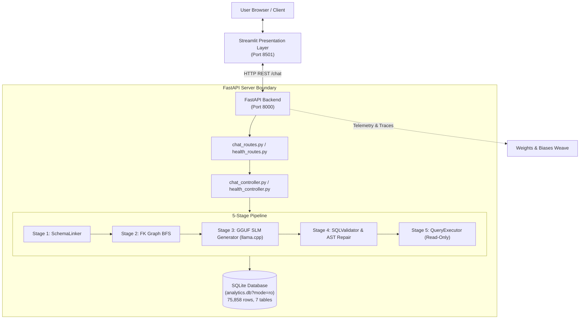
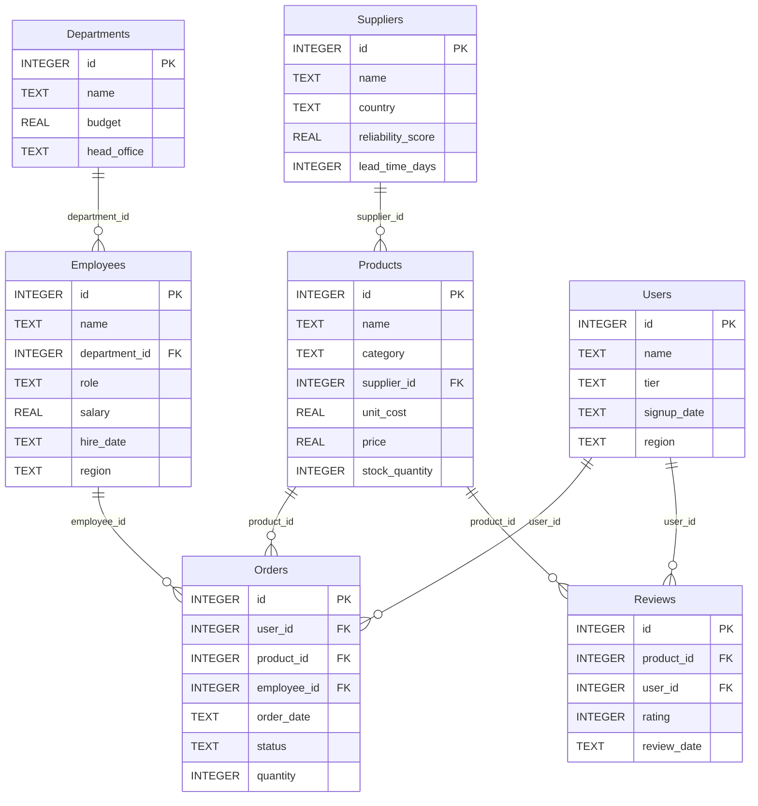

# System Architecture & Technical Specifications

This document defines the end-to-end architecture, component contracts, and design rationales for the Enterprise SLM Text-to-SQL Analytics Platform.

---

## 1. High-Level System Topology



---

## 2. Relational Database Schema & Foreign-Key Topology

The application database (`backend/analytics.db`) contains **75,858 records across 7 normalized tables**:



---

## 3. The 5-Stage Pipeline Contracts

### Stage 1: Dynamic Catalog Introspection & Keyword/Value Schema Linker
- **Module:** `backend/services/schema_linker.py`
- **Contract:** `link_schema(question: str) -> tuple[str, list[str]]`
- **Output:** Returns a formatted DDL string containing *only* the relevant tables, plus a list of their names.
- **Mechanism:**
  - Tokenizes question with word stemming (`"employees"` $\rightarrow$ `Employees`).
  - Matches categorical values via an inverted index (`value_to_table_col`) for columns with $\le 20$ distinct values (e.g. `'Europe'`, `'Germany'`).
  - Matches non-FK attribute columns to pull in missing anchor tables.

### Stage 2: Shortest-Path Foreign-Key Graph Expansion
- **Module:** `backend/services/schema_linker.py`
- **Contract:** `_expand_foreign_key_paths(seed_tables: set[str]) -> set[str]`
- **Mechanism:**
  - Runs Breadth-First Search (BFS) over the table adjacency list built from `PRAGMA foreign_key_list`.
  - Discovers bridge tables when two selected tables are not directly linked (e.g., `Users` and `Products` are joined via `Orders`).

### Stage 3: Zero-Fallback 1B GGUF Model Generation
- **Module:** `backend/services/sql_generator.py`
- **Contract:** `generate_sql(question: str, schema: str) -> tuple[str, float]`
- **Engine:** `llama-cpp-python` with `llama-3.2-1b-sql-q4_k_m.gguf`.
- **Mechanism:**
  - Formats query into Alpaca prompt template.
  - Greedy decoding (`temperature=0.0`) with stop tokens `["<|end_of_text|>", "<|eot_id|>", "###", "\n\n"]`.
  - Strips code fences, comments, and semicolons to emit raw SQL.

### Stage 4: Pre-Execution SQL Validator & AST Repair
- **Module:** `backend/services/sql_validator.py`
- **Contract:** `validate(question: str, sql: str, llm_repair=None) -> tuple[str, list[str]]`
- **Mechanism:**
  - Applies 10 deterministic repair rules against the SQLite catalog.
  - Verifies query with SQLite `EXPLAIN QUERY PLAN`.
  - If syntax or planner fails, calls bounded 1-turn LLM repair prompt with error message.

### Stage 5: Sandboxed Read-Only SQLite Execution
- **Module:** `backend/database/query_executor.py`
- **Contract:** `run_query(sql: str) -> dict[str, Any]`
- **Mechanism:**
  - Connects using URI `file:analytics.db?mode=ro`.
  - Sets progress handler to enforce a 5-second instruction ceiling.
  - Returns `{"columns": [...], "results": [...], "row_count": N, "execution_ms": float}`.

---

## 4. API Specification

### `POST /chat`
- **Request:** `{"question": "What is the total quantity of products ordered by users in Europe?"}`
- **Response:**
  ```json
  {
    "question": "What is the total quantity of products ordered by users in Europe?",
    "sql": "SELECT SUM(T1.quantity) FROM Orders AS T1 JOIN Users AS T2 ON T1.user_id = T2.id WHERE T2.region = 'Europe';",
    "linked_tables": ["Orders", "Users"],
    "repairs_applied": [],
    "inference_ms": 1150.4,
    "execution_ms": 8.2,
    "row_count": 1,
    "columns": ["SUM(T1.quantity)"],
    "results": [{"SUM(T1.quantity)": 41250}],
    "engine": "llama.cpp (llama-3.2-1b-sql-q4_k_m.gguf)"
  }
  ```

### `GET /health`
- **Response:** Reports service status, model path, engine name, total database rows, and table row counts.

### `GET /schema`
- **Response:** Returns complete schema DDL, table column definitions, and foreign-key link directory.

